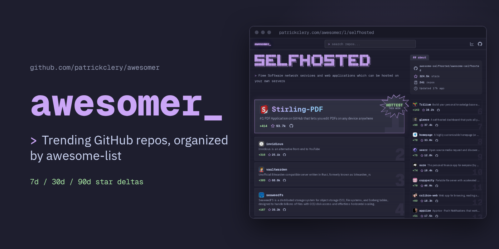

  

<h1 align="center">awesomer</h1>

  <strong>Trending GitHub repos, organized by awesome-list.</strong> 
  7d / 30d / 90d star deltas across curated awesome-lists.

  <a href="https://patrickclery.com/awesomer/">Live ↗</a> ·
  <a href="https://github.com/patrickclery/awesomer">GitHub ↗</a>

  

## Hottest This Week: [awesome](l/awesome.md)

> 😎 Awesome lists about all kinds of interesting topics [NOTE: Pull requests are temporarily disabled until I have a chan

| Stars | 7d | 30d | 90d |
|-------|----|-----|-----|
| 526,536 | +3,918 | +14,330 | +35,509 |

## Top 10 Trending Repos

| # | Repo | List | Stars | 7d |
|---|------|------|-------|----|
| 1 | [rea](r/morluto~rea.md) | [Awesome Open Source AI](l/opensource-ai.md) | 405,159 | +43,243 |
| 2 | [security-audit-skill](r/cloudflare~security-audit-skill.md) | [awesome-agent-skills](l/agent-skills.md) | 52,217 | +14,254 |
| 3 | [VoiceStudio](r/debpalash~voicestudio.md) | [Awesome Open Source AI](l/opensource-ai.md) | 93,621 | +12,544 |
| 4 | [hallmark](r/nutlope~hallmark.md) | [Awesome Open Source AI](l/opensource-ai.md) | 41,412 | +10,803 |
| 5 | [impeccable](r/pbakaus~impeccable.md) | [Awesome Open Source AI](l/opensource-ai.md) | 94,065 | +9,368 |
| 6 | [orca](r/stablyai~orca.md) | [Awesome Open Source AI](l/opensource-ai.md) | 109,618 | +7,511 |
| 7 | [DeepTutor](r/hkuds~deeptutor.md) | [Awesome Open Source AI](l/opensource-ai.md) | 48,961 | +6,859 |
| 8 | [ECC](r/affaan-m~ecc.md) | [Awesome Open Source AI](l/opensource-ai.md) | 292,164 | +6,102 |
| 9 | [graphify](r/graphify-labs~graphify.md) | [Awesome Open Source AI](l/opensource-ai.md) | 138,209 | +5,980 |
| 10 | [graphify](r/safishamsi~graphify.md) | [Awesome Open Source AI](l/opensource-ai.md) | 138,213 | +5,972 |

## All Awesome Lists

| List | Description | Stars | 7d |
|------|-------------|-------|----|
| [awesome](l/awesome.md) | 😎 Awesome lists about all kinds of interesting topics [NOTE: Pull requests are temporarily disabled until I have a chan | 526,536 | +3,918 |
| [awesome-selfhosted](l/selfhosted.md) | A list of Free Software network services and web applications which can be hosted on your own servers | 331,603 | +2,420 |
| [awesome-mac](l/mac.md) |  This project is dedicated to collecting high-quality macOS software and organizing them systematically by different ca | 117,306 | +592 |
| [awesome-claude-code](l/claude-code.md) | A hand-picked collection of the finest of resources for the most awesome of agents, Claude Code, the undisputed champion | 56,806 | +580 |
| [awesome-claude-skills](l/claude-skills.md) | A curated list of awesome Claude Skills, resources, and tools for customizing Claude AI workflows | 78,234 | +580 |
| [awesome-agent-skills](l/agent-skills.md) | A curated collection of 1000+ agent skills from official dev teams and the community, compatible with Claude Code, Codex | 36,547 | +391 |
| [awesome-mcp-servers](l/mcp-servers.md) | A collection of MCP servers. | 97,020 | +280 |
| [Awesome AI Agents](l/ai-agents.md) | A list of AI autonomous agents | 30,695 | +126 |
| [awesome-osint](l/osint.md) | 😱 A curated list of amazingly awesome OSINT | 30,536 | +120 |
| [awesome-nodejs](l/nodejs.md) | ⚡ Delightful Node.js packages and resources [BECAUSE OF TOO MUCH SPAM AND LOW-QUALITY SUBMISSIONS, SUBMISSIONS ARE PAUSE | 67,294 | +80 |
| [awesome-github-profile-readme](l/github-profile-readme.md) | 😎 A curated list of awesome GitHub Profile which updates in real time  | 31,461 | +62 |
| [awesome-docker](l/docker.md) | 🐳 A curated list of Docker resources and projects | 37,131 | +47 |
| [awesome-machine-learning](l/machine-learning.md) | A curated list of awesome Machine Learning frameworks, libraries and software. | 74,686 | +44 |
| [awesome-actions](l/actions.md) | A curated list of awesome actions to use on GitHub | 28,379 | +43 |
| [awesome-shell](l/shell.md) | A curated list of awesome command-line frameworks, toolkits, guides and gizmos. Inspired by awesome-php. | 37,858 | +39 |
| [Awesome Open Source AI](l/opensource-ai.md) | Curated list of the best truly open-source AI projects, models, tools, and infrastructure. Daily updated. | 4,948 | +29 |
| [awesome-cto](l/cto.md) | A curated and opinionated list of resources for Chief Technology Officers, with the emphasis on startups | 35,654 | +27 |
| [awesome-ai-in-finance](l/ai-in-finance.md) | 🔬 A curated list of awesome LLMs & deep learning strategies & tools in financial market. | 6,705 | +24 |
| [awesome-tunneling](l/tunneling.md) | List of ngrok, Cloudflare Tunnel, Tailscale, and ZeroTier alternatives and other tunneling software and services. Focus  | 21,991 | +23 |
| [Awesome local LLM](l/local-llm.md) | A curated list of awesome platforms, tools, practices and resources that helps run LLMs locally | 3,012 | +22 |
| [awesome-cli-apps](l/cli-apps.md) | 🖥 📊 🕹 🛠 A curated list of command line apps | 20,579 | +22 |
| [awesome-neovim](l/neovim.md) | Collections of awesome neovim plugins. | 21,523 | +19 |
| [awesome-zsh-plugins](l/zsh-plugins.md) | A collection of ZSH frameworks, plugins, themes and tutorials. | 18,096 | +18 |
| [awesome-vite](l/vite.md) | ⚡️ A curated list of awesome things related to Vite.js | 17,284 | +14 |
| [awesome-arr](l/arr.md) | A collection of *arrs and related stuff. | 4,445 | +13 |
| [awesome-ruby](l/ruby.md) | 💎 A collection of awesome Ruby libraries, tools, frameworks and software | 14,183 | +9 |
| [Awesome-Linux-Software](l/linux-software.md) | 🐧 A list of awesome Linux softwares  | 25,648 | +5 |
| [awesome-db-tools](l/db-tools.md) | Everything that makes working with databases easier | 5,351 | +5 |
| [awesome-nestjs](l/nestjs.md) | A curated list of awesome things related to NestJS 😎 | 13,181 | +5 |
| [awesome-tailwindcss](l/tailwindcss.md) | 😎 Awesome things related to Tailwind CSS | 15,211 | +5 |
| [awesome-piracy](l/piracy.md) | A curated list of awesome warez and piracy links | 26,916 | +4 |
| [awesome-opensource-email](l/opensource-email.md) | Awesome Opensource Email Resources | 1,235 | +2 |
| [awesome-postgres](l/postgres.md) | A curated list of awesome PostgreSQL software, libraries, tools and resources, inspired by awesome-mysql | 12,125 | +2 |
| [awesome-nextjs](l/nextjs.md) | 📔 📚 A curated list of awesome resources : books, videos, articles about using Next.js (A minimalistic framework for un | 11,106 | +2 |
| [awesome-playwright](l/playwright.md) | A curated list of awesome tools, utils and projects using Playwright | 1,599 | +0 |
| [Awesome Immich](l/immich.md) | Sites and packages for Immich | 17 | -1 |
| [awesome-linux-containers](l/linux-containers.md) | A curated list of awesome Linux Containers frameworks, libraries and software | 2,108 | -1 |

---
*Updated: 2026-10-29 | [View live site ↗](https://patrickclery.com/awesomer/)*
