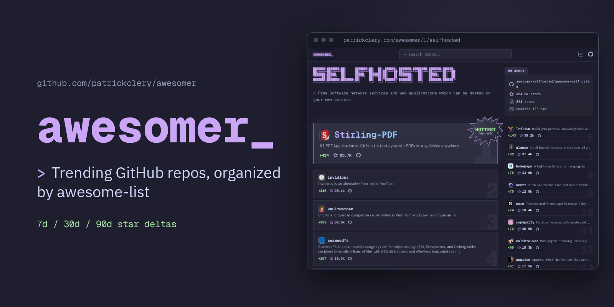

  

<h1 align="center">awesomer</h1>

  <strong>Trending GitHub repos, organized by awesome-list.</strong> 
  7d / 30d / 90d star deltas across curated awesome-lists.

  <a href="https://patrickclery.com/awesomer/">Live ↗</a> ·
  <a href="https://github.com/patrickclery/awesomer">GitHub ↗</a>

  

## Hottest This Week: [awesome](https://github.com/patrickclery/awesomer/blob/gh-pages/l/awesome.md)

> 😎 Awesome lists about all kinds of interesting topics [NOTE: Pull requests are temporarily disabled until I have a chan

| Stars | 7d | 30d | 90d |
|-------|----|-----|-----|
| 537,699 | +3,558 | +17,477 | +40,516 |

## Top 10 Trending Repos

| # | Repo | List | Stars | 7d |
|---|------|------|-------|----|
| 1 | [rea](https://github.com/patrickclery/awesomer/blob/gh-pages/r/morluto~rea.md) | [Awesome Open Source AI](https://github.com/patrickclery/awesomer/blob/gh-pages/l/opensource-ai.md) | 462,984 | +17,681 |
| 2 | [t3code](https://github.com/patrickclery/awesomer/blob/gh-pages/r/pingdotgg~t3code.md) | [Awesome local LLM](https://github.com/patrickclery/awesomer/blob/gh-pages/l/local-llm.md) | 62,127 | +8,944 |
| 3 | [sherlock](https://github.com/patrickclery/awesomer/blob/gh-pages/r/sherlock-project~sherlock.md) | [awesome-iam](https://github.com/patrickclery/awesomer/blob/gh-pages/l/iam.md) | 112,848 | +7,072 |
| 4 | [skills](https://github.com/patrickclery/awesomer/blob/gh-pages/r/mattpocock~skills.md) | [awesome-agent-skills](https://github.com/patrickclery/awesomer/blob/gh-pages/l/agent-skills.md) | 325,563 | +6,477 |
| 5 | [orca](https://github.com/patrickclery/awesomer/blob/gh-pages/r/stablyai~orca.md) | [Awesome Open Source AI](https://github.com/patrickclery/awesomer/blob/gh-pages/l/opensource-ai.md) | 126,247 | +6,419 |
| 6 | [security-audit-skill](https://github.com/patrickclery/awesomer/blob/gh-pages/r/cloudflare~security-audit-skill.md) | [awesome-agent-skills](https://github.com/patrickclery/awesomer/blob/gh-pages/l/agent-skills.md) | 73,498 | +6,118 |
| 7 | [VoiceStudio](https://github.com/patrickclery/awesomer/blob/gh-pages/r/debpalash~voicestudio.md) | [Awesome Open Source AI](https://github.com/patrickclery/awesomer/blob/gh-pages/l/opensource-ai.md) | 111,637 | +6,111 |
| 8 | [skills](https://github.com/patrickclery/awesomer/blob/gh-pages/r/anthropics~skills.md) | [awesome-claude-skills](https://github.com/patrickclery/awesomer/blob/gh-pages/l/claude-skills.md) | 195,636 | +5,549 |
| 9 | [OpenMausBot](https://github.com/patrickclery/awesomer/blob/gh-pages/r/milind-soni~openmausbot.md) | [Awesome Open Source AI](https://github.com/patrickclery/awesomer/blob/gh-pages/l/opensource-ai.md) | 23,870 | +4,754 |
| 10 | [sure](https://github.com/patrickclery/awesomer/blob/gh-pages/r/we-promise~sure.md) | [awesome-selfhosted](https://github.com/patrickclery/awesomer/blob/gh-pages/l/selfhosted.md) | 15,847 | +4,628 |

## All Awesome Lists

| List | Description | Stars | 7d |
|------|-------------|-------|----|
| [awesome](https://github.com/patrickclery/awesomer/blob/gh-pages/l/awesome.md) | 😎 Awesome lists about all kinds of interesting topics [NOTE: Pull requests are temporarily disabled until I have a chan | 537,699 | +3,558 |
| [awesome-selfhosted](https://github.com/patrickclery/awesomer/blob/gh-pages/l/selfhosted.md) | A list of Free Software network services and web applications which can be hosted on your own servers | 337,553 | +2,255 |
| [awesome-claude-code](https://github.com/patrickclery/awesomer/blob/gh-pages/l/claude-code.md) | A hand-picked collection of the finest of resources for the most awesome of agents, Claude Code, the undisputed champion | 58,119 | +540 |
| [awesome-mac](https://github.com/patrickclery/awesomer/blob/gh-pages/l/mac.md) |  This project is dedicated to collecting high-quality macOS software and organizing them systematically by different ca | 118,637 | +529 |
| [awesome-claude-skills](https://github.com/patrickclery/awesomer/blob/gh-pages/l/claude-skills.md) | A curated list of awesome Claude Skills, resources, and tools for customizing Claude AI workflows | 79,616 | +522 |
| [awesome-mcp-servers](https://github.com/patrickclery/awesomer/blob/gh-pages/l/mcp-servers.md) | A collection of MCP servers. | 97,754 | +243 |
| [awesome-agent-skills](https://github.com/patrickclery/awesomer/blob/gh-pages/l/agent-skills.md) | A curated collection of 1000+ agent skills from official dev teams and the community, compatible with Claude Code, Codex | 37,231 | +242 |
| [awesome-osint](https://github.com/patrickclery/awesomer/blob/gh-pages/l/osint.md) | 😱 A curated list of amazingly awesome OSINT | 31,134 | +208 |
| [awesome-nodejs](https://github.com/patrickclery/awesomer/blob/gh-pages/l/nodejs.md) | ⚡ Delightful Node.js packages and resources [BECAUSE OF TOO MUCH SPAM AND LOW-QUALITY SUBMISSIONS, SUBMISSIONS ARE PAUSE | 67,525 | +103 |
| [Awesome AI Agents](https://github.com/patrickclery/awesomer/blob/gh-pages/l/ai-agents.md) | A list of AI autonomous agents | 30,952 | +84 |
| [awesome-github-profile-readme](https://github.com/patrickclery/awesomer/blob/gh-pages/l/github-profile-readme.md) | 😎 A curated list of awesome GitHub Profile which updates in real time  | 31,620 | +60 |
| [awesome-machine-learning](https://github.com/patrickclery/awesomer/blob/gh-pages/l/machine-learning.md) | A curated list of awesome Machine Learning frameworks, libraries and software. | 74,839 | +54 |
| [awesome-docker](https://github.com/patrickclery/awesomer/blob/gh-pages/l/docker.md) | 🐳 A curated list of Docker resources and projects | 37,244 | +47 |
| [awesome-shell](https://github.com/patrickclery/awesomer/blob/gh-pages/l/shell.md) | A curated list of awesome command-line frameworks, toolkits, guides and gizmos. Inspired by awesome-php. | 37,966 | +35 |
| [awesome-cto](https://github.com/patrickclery/awesomer/blob/gh-pages/l/cto.md) | A curated and opinionated list of resources for Chief Technology Officers, with the emphasis on startups | 35,760 | +35 |
| [awesome-actions](https://github.com/patrickclery/awesomer/blob/gh-pages/l/actions.md) | A curated list of awesome actions to use on GitHub | 28,442 | +27 |
| [Awesome Open Source AI](https://github.com/patrickclery/awesomer/blob/gh-pages/l/opensource-ai.md) | Curated list of the best truly open-source AI projects, models, tools, and infrastructure. Daily updated. | 5,040 | +27 |
| [Awesome local LLM](https://github.com/patrickclery/awesomer/blob/gh-pages/l/local-llm.md) | A curated list of awesome platforms, tools, practices and resources that helps run LLMs locally | 3,073 | +24 |
| [awesome-neovim](https://github.com/patrickclery/awesomer/blob/gh-pages/l/neovim.md) | Collections of awesome neovim plugins. | 21,585 | +24 |
| [awesome-ai-in-finance](https://github.com/patrickclery/awesomer/blob/gh-pages/l/ai-in-finance.md) | 🔬 A curated list of awesome LLMs & deep learning strategies & tools in financial market. | 6,759 | +24 |
| [awesome-arr](https://github.com/patrickclery/awesomer/blob/gh-pages/l/arr.md) | A collection of *arrs and related stuff. | 4,501 | +23 |
| [awesome-postgres](https://github.com/patrickclery/awesomer/blob/gh-pages/l/postgres.md) | A curated list of awesome PostgreSQL software, libraries, tools and resources, inspired by awesome-mysql | 12,188 | +19 |
| [awesome-cli-apps](https://github.com/patrickclery/awesomer/blob/gh-pages/l/cli-apps.md) | 🖥 📊 🕹 🛠 A curated list of command line apps | 20,628 | +17 |
| [awesome-tunneling](https://github.com/patrickclery/awesomer/blob/gh-pages/l/tunneling.md) | List of ngrok, Cloudflare Tunnel, Tailscale, and ZeroTier alternatives and other tunneling software and services. Focus  | 22,050 | +16 |
| [awesome-vite](https://github.com/patrickclery/awesomer/blob/gh-pages/l/vite.md) | ⚡️ A curated list of awesome things related to Vite.js | 17,296 | +12 |
| [awesome-zsh-plugins](https://github.com/patrickclery/awesomer/blob/gh-pages/l/zsh-plugins.md) | A collection of ZSH frameworks, plugins, themes and tutorials. | 18,139 | +12 |
| [awesome-nestjs](https://github.com/patrickclery/awesomer/blob/gh-pages/l/nestjs.md) | A curated list of awesome things related to NestJS 😎 | 13,202 | +10 |
| [awesome-playwright](https://github.com/patrickclery/awesomer/blob/gh-pages/l/playwright.md) | A curated list of awesome tools, utils and projects using Playwright | 1,614 | +9 |
| [awesome-tailwindcss](https://github.com/patrickclery/awesomer/blob/gh-pages/l/tailwindcss.md) | 😎 Awesome things related to Tailwind CSS | 15,238 | +9 |
| [awesome-piracy](https://github.com/patrickclery/awesomer/blob/gh-pages/l/piracy.md) | A curated list of awesome warez and piracy links | 26,921 | +7 |
| [awesome-linux-containers](https://github.com/patrickclery/awesomer/blob/gh-pages/l/linux-containers.md) | A curated list of awesome Linux Containers frameworks, libraries and software | 2,115 | +6 |
| [Awesome-Linux-Software](https://github.com/patrickclery/awesomer/blob/gh-pages/l/linux-software.md) | 🐧 A list of awesome Linux softwares  | 25,655 | +6 |
| [awesome-db-tools](https://github.com/patrickclery/awesomer/blob/gh-pages/l/db-tools.md) | Everything that makes working with databases easier | 5,363 | +4 |
| [awesome-nextjs](https://github.com/patrickclery/awesomer/blob/gh-pages/l/nextjs.md) | 📔 📚 A curated list of awesome resources : books, videos, articles about using Next.js (A minimalistic framework for un | 11,109 | +3 |
| [awesome-opensource-email](https://github.com/patrickclery/awesomer/blob/gh-pages/l/opensource-email.md) | Awesome Opensource Email Resources | 1,240 | +2 |
| [awesome-ruby](https://github.com/patrickclery/awesomer/blob/gh-pages/l/ruby.md) | 💎 A collection of awesome Ruby libraries, tools, frameworks and software | 14,187 | +2 |
| [Awesome Immich](https://github.com/patrickclery/awesomer/blob/gh-pages/l/immich.md) | Sites and packages for Immich | 19 | +1 |

---
*Updated: 2026-11-16 | [View live site ↗](https://patrickclery.com/awesomer/)*
