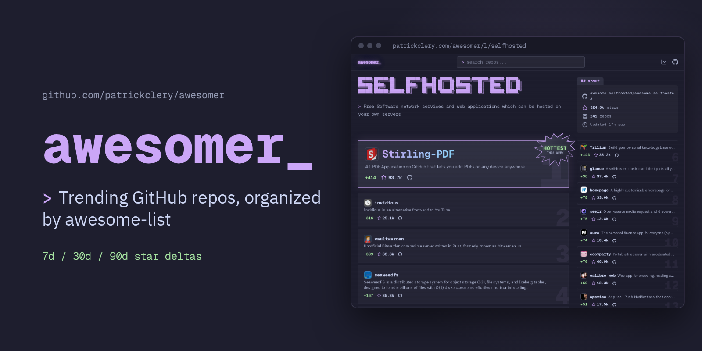

  

<h1 align="center">awesomer</h1>

  <strong>Trending GitHub repos, organized by awesome-list.</strong> 
  7d / 30d / 90d star deltas across curated awesome-lists.

  <a href="https://patrickclery.com/awesomer/">Live ↗</a> ·
  <a href="https://github.com/patrickclery/awesomer">GitHub ↗</a>

  

## Hottest This Week: [awesome](https://github.com/patrickclery/awesomer/blob/gh-pages/l/awesome.md)

> 😎 Awesome lists about all kinds of interesting topics [NOTE: Pull requests are temporarily disabled until I have a chan

| Stars | 7d | 30d | 90d |
|-------|----|-----|-----|
| 532,065 | +4,958 | +16,219 | +38,496 |

## Top 10 Trending Repos

| # | Repo | List | Stars | 7d |
|---|------|------|-------|----|
| 1 | [rea](https://github.com/patrickclery/awesomer/blob/gh-pages/r/morluto~rea.md) | [Awesome Open Source AI](https://github.com/patrickclery/awesomer/blob/gh-pages/l/opensource-ai.md) | 436,108 | +26,064 |
| 2 | [t3code](https://github.com/patrickclery/awesomer/blob/gh-pages/r/pingdotgg~t3code.md) | [Awesome Open Source AI](https://github.com/patrickclery/awesomer/blob/gh-pages/l/opensource-ai.md) | 48,889 | +16,649 |
| 3 | [security-audit-skill](https://github.com/patrickclery/awesomer/blob/gh-pages/r/cloudflare~security-audit-skill.md) | [awesome-agent-skills](https://github.com/patrickclery/awesomer/blob/gh-pages/l/agent-skills.md) | 62,624 | +9,282 |
| 4 | [skills](https://github.com/patrickclery/awesomer/blob/gh-pages/r/mattpocock~skills.md) | [awesome-agent-skills](https://github.com/patrickclery/awesomer/blob/gh-pages/l/agent-skills.md) | 316,050 | +9,074 |
| 5 | [claude-mem](https://github.com/patrickclery/awesomer/blob/gh-pages/r/thedotmack~claude-mem.md) | [awesome-agent-skills](https://github.com/patrickclery/awesomer/blob/gh-pages/l/agent-skills.md) | 113,749 | +8,482 |
| 6 | [Scrapling](https://github.com/patrickclery/awesomer/blob/gh-pages/r/d4vinci~scrapling.md) | [Awesome Open Source AI](https://github.com/patrickclery/awesomer/blob/gh-pages/l/opensource-ai.md) | 98,548 | +8,164 |
| 7 | [impeccable](https://github.com/patrickclery/awesomer/blob/gh-pages/r/pbakaus~impeccable.md) | [Awesome Open Source AI](https://github.com/patrickclery/awesomer/blob/gh-pages/l/opensource-ai.md) | 104,335 | +8,029 |
| 8 | [VoiceStudio](https://github.com/patrickclery/awesomer/blob/gh-pages/r/debpalash~voicestudio.md) | [Awesome Open Source AI](https://github.com/patrickclery/awesomer/blob/gh-pages/l/opensource-ai.md) | 102,351 | +7,417 |
| 9 | [hallmark](https://github.com/patrickclery/awesomer/blob/gh-pages/r/nutlope~hallmark.md) | [Awesome Open Source AI](https://github.com/patrickclery/awesomer/blob/gh-pages/l/opensource-ai.md) | 49,162 | +6,765 |
| 10 | [orca](https://github.com/patrickclery/awesomer/blob/gh-pages/r/stablyai~orca.md) | [Awesome Open Source AI](https://github.com/patrickclery/awesomer/blob/gh-pages/l/opensource-ai.md) | 117,218 | +6,586 |

## All Awesome Lists

| List | Description | Stars | 7d |
|------|-------------|-------|----|
| [awesome](https://github.com/patrickclery/awesomer/blob/gh-pages/l/awesome.md) | 😎 Awesome lists about all kinds of interesting topics [NOTE: Pull requests are temporarily disabled until I have a chan | 532,065 | +4,958 |
| [awesome-selfhosted](https://github.com/patrickclery/awesomer/blob/gh-pages/l/selfhosted.md) | A list of Free Software network services and web applications which can be hosted on your own servers | 334,305 | +2,350 |
| [awesome-claude-skills](https://github.com/patrickclery/awesomer/blob/gh-pages/l/claude-skills.md) | A curated list of awesome Claude Skills, resources, and tools for customizing Claude AI workflows | 78,899 | +579 |
| [awesome-claude-code](https://github.com/patrickclery/awesomer/blob/gh-pages/l/claude-code.md) | A hand-picked collection of the finest of resources for the most awesome of agents, Claude Code, the undisputed champion | 57,367 | +470 |
| [awesome-mac](https://github.com/patrickclery/awesomer/blob/gh-pages/l/mac.md) |  This project is dedicated to collecting high-quality macOS software and organizing them systematically by different ca | 117,838 | +468 |
| [awesome-agent-skills](https://github.com/patrickclery/awesomer/blob/gh-pages/l/agent-skills.md) | A curated collection of 1000+ agent skills from official dev teams and the community, compatible with Claude Code, Codex | 36,914 | +309 |
| [awesome-mcp-servers](https://github.com/patrickclery/awesomer/blob/gh-pages/l/mcp-servers.md) | A collection of MCP servers. | 97,363 | +293 |
| [awesome-osint](https://github.com/patrickclery/awesomer/blob/gh-pages/l/osint.md) | 😱 A curated list of amazingly awesome OSINT | 30,799 | +230 |
| [Awesome AI Agents](https://github.com/patrickclery/awesomer/blob/gh-pages/l/ai-agents.md) | A list of AI autonomous agents | 30,813 | +103 |
| [awesome-nodejs](https://github.com/patrickclery/awesomer/blob/gh-pages/l/nodejs.md) | ⚡ Delightful Node.js packages and resources [BECAUSE OF TOO MUCH SPAM AND LOW-QUALITY SUBMISSIONS, SUBMISSIONS ARE PAUSE | 67,393 | +85 |
| [awesome-machine-learning](https://github.com/patrickclery/awesomer/blob/gh-pages/l/machine-learning.md) | A curated list of awesome Machine Learning frameworks, libraries and software. | 74,766 | +76 |
| [awesome-github-profile-readme](https://github.com/patrickclery/awesomer/blob/gh-pages/l/github-profile-readme.md) | 😎 A curated list of awesome GitHub Profile which updates in real time  | 31,534 | +60 |
| [awesome-shell](https://github.com/patrickclery/awesomer/blob/gh-pages/l/shell.md) | A curated list of awesome command-line frameworks, toolkits, guides and gizmos. Inspired by awesome-php. | 37,918 | +54 |
| [awesome-docker](https://github.com/patrickclery/awesomer/blob/gh-pages/l/docker.md) | 🐳 A curated list of Docker resources and projects | 37,183 | +45 |
| [awesome-cto](https://github.com/patrickclery/awesomer/blob/gh-pages/l/cto.md) | A curated and opinionated list of resources for Chief Technology Officers, with the emphasis on startups | 35,704 | +41 |
| [Awesome Open Source AI](https://github.com/patrickclery/awesomer/blob/gh-pages/l/opensource-ai.md) | Curated list of the best truly open-source AI projects, models, tools, and infrastructure. Daily updated. | 4,992 | +38 |
| [Awesome local LLM](https://github.com/patrickclery/awesomer/blob/gh-pages/l/local-llm.md) | A curated list of awesome platforms, tools, practices and resources that helps run LLMs locally | 3,040 | +28 |
| [awesome-zsh-plugins](https://github.com/patrickclery/awesomer/blob/gh-pages/l/zsh-plugins.md) | A collection of ZSH frameworks, plugins, themes and tutorials. | 18,123 | +26 |
| [awesome-tunneling](https://github.com/patrickclery/awesomer/blob/gh-pages/l/tunneling.md) | List of ngrok, Cloudflare Tunnel, Tailscale, and ZeroTier alternatives and other tunneling software and services. Focus  | 22,019 | +25 |
| [awesome-cli-apps](https://github.com/patrickclery/awesomer/blob/gh-pages/l/cli-apps.md) | 🖥 📊 🕹 🛠 A curated list of command line apps | 20,605 | +24 |
| [awesome-actions](https://github.com/patrickclery/awesomer/blob/gh-pages/l/actions.md) | A curated list of awesome actions to use on GitHub | 28,408 | +23 |
| [awesome-arr](https://github.com/patrickclery/awesomer/blob/gh-pages/l/arr.md) | A collection of *arrs and related stuff. | 4,470 | +21 |
| [awesome-neovim](https://github.com/patrickclery/awesomer/blob/gh-pages/l/neovim.md) | Collections of awesome neovim plugins. | 21,550 | +20 |
| [awesome-ai-in-finance](https://github.com/patrickclery/awesomer/blob/gh-pages/l/ai-in-finance.md) | 🔬 A curated list of awesome LLMs & deep learning strategies & tools in financial market. | 6,726 | +17 |
| [awesome-tailwindcss](https://github.com/patrickclery/awesomer/blob/gh-pages/l/tailwindcss.md) | 😎 Awesome things related to Tailwind CSS | 15,224 | +12 |
| [awesome-nestjs](https://github.com/patrickclery/awesomer/blob/gh-pages/l/nestjs.md) | A curated list of awesome things related to NestJS 😎 | 13,194 | +11 |
| [awesome-postgres](https://github.com/patrickclery/awesomer/blob/gh-pages/l/postgres.md) | A curated list of awesome PostgreSQL software, libraries, tools and resources, inspired by awesome-mysql | 12,136 | +9 |
| [awesome-db-tools](https://github.com/patrickclery/awesomer/blob/gh-pages/l/db-tools.md) | Everything that makes working with databases easier | 5,357 | +6 |
| [awesome-playwright](https://github.com/patrickclery/awesomer/blob/gh-pages/l/playwright.md) | A curated list of awesome tools, utils and projects using Playwright | 1,604 | +4 |
| [awesome-piracy](https://github.com/patrickclery/awesomer/blob/gh-pages/l/piracy.md) | A curated list of awesome warez and piracy links | 26,918 | +3 |
| [awesome-opensource-email](https://github.com/patrickclery/awesomer/blob/gh-pages/l/opensource-email.md) | Awesome Opensource Email Resources | 1,237 | +2 |
| [awesome-ruby](https://github.com/patrickclery/awesomer/blob/gh-pages/l/ruby.md) | 💎 A collection of awesome Ruby libraries, tools, frameworks and software | 14,187 | +2 |
| [awesome-vite](https://github.com/patrickclery/awesomer/blob/gh-pages/l/vite.md) | ⚡️ A curated list of awesome things related to Vite.js | 17,287 | +2 |
| [awesome-linux-containers](https://github.com/patrickclery/awesomer/blob/gh-pages/l/linux-containers.md) | A curated list of awesome Linux Containers frameworks, libraries and software | 2,109 | +1 |
| [Awesome Immich](https://github.com/patrickclery/awesomer/blob/gh-pages/l/immich.md) | Sites and packages for Immich | 18 | +1 |
| [Awesome-Linux-Software](https://github.com/patrickclery/awesomer/blob/gh-pages/l/linux-software.md) | 🐧 A list of awesome Linux softwares  | 25,648 | +0 |
| [awesome-nextjs](https://github.com/patrickclery/awesomer/blob/gh-pages/l/nextjs.md) | 📔 📚 A curated list of awesome resources : books, videos, articles about using Next.js (A minimalistic framework for un | 11,105 | -2 |

---
*Updated: 2026-11-06 | [View live site ↗](https://patrickclery.com/awesomer/)*
